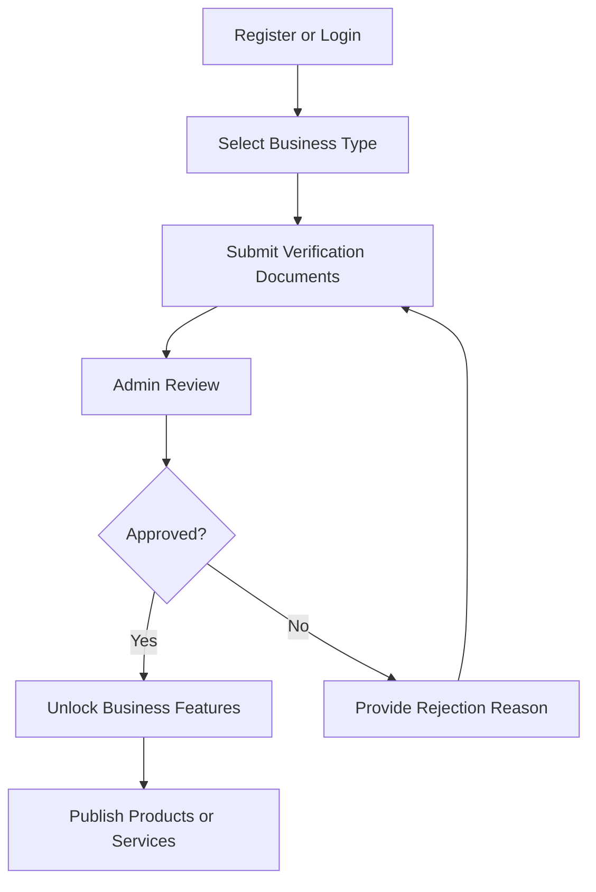
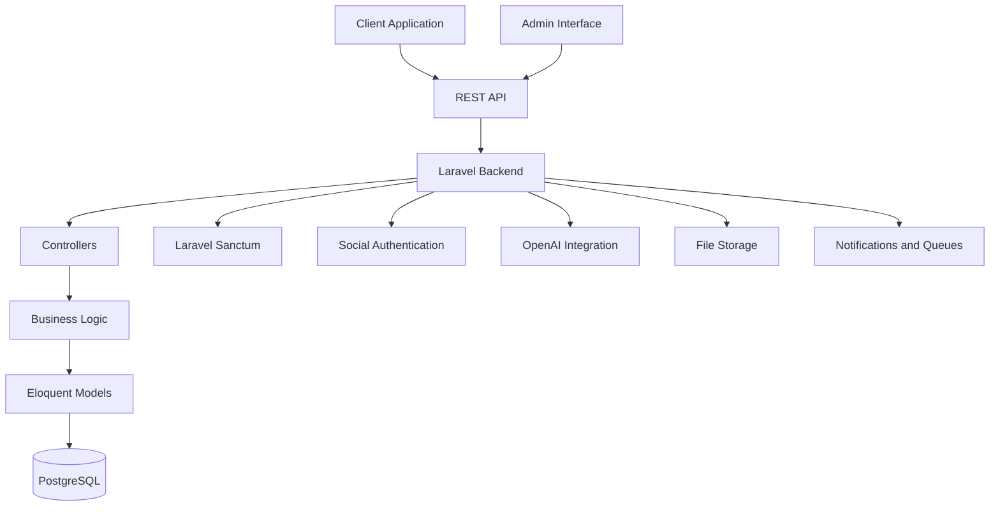

# 🐾 Pawzo — Backend API


> Connecting pets, people, and services through one intelligent platform.

## 📖 Project Overview

Pawzo is a comprehensive pet management and animal welfare platform
designed to connect pet owners, service providers, businesses,
and animal lovers within a single digital ecosystem.

The Pawzo backend provides RESTful APIs for authentication,
pet profile management, digital health records, lost and found
pet reporting, smart pet matching, business verification,
marketplace management, AI-powered assistance, and administrative
operations.

The platform aims to improve pet care, promote animal welfare,
reunite missing pets with their owners, and provide convenient
access to trusted pet-related services.

---

## 🎯 Project Objectives

- Simplify pet care and health record management.
- Help owners locate missing pets through smart matching.
- Promote animal welfare through stray animal reporting.
- Connect pet owners with verified service providers.
- Provide a centralized pet products and services marketplace.
- Offer AI-powered pet-related assistance.
- Maintain a trusted and secure digital environment.

---

## ✨ Platform Features

The following modules represent the project's functional scope.
Implementation and testing status may vary by module.

### 🔐 Authentication & User Management

- Email and password registration.
- Secure user login and logout.
- OTP-based email verification.
- Resend OTP.
- Google and Facebook authentication.
- Forgot and reset password.
- User profile and avatar management.
- Token-based API authentication.

### 🐶 Pet Profile Management

- Create and manage multiple pet profiles.
- Store pet name, type, breed, gender, age, color, and weight.
- Upload and manage pet photographs.
- Update and delete pet profiles.
- Generate suitable pet names based on user preferences.

### 🔍 Lost & Found Pets

- Create lost pet reports.
- Create found pet reports.
- Upload pet photographs and descriptions.
- Record missing and found locations.
- Provide contact information.
- Browse nearby pet reports.
- Track possible matching cases.

### 🤖 Smart Lost-Pet Matching

Identify potential matches between lost and found pet reports
using information such as:

- Breed
- Color
- Gender
- Geographic location
- Report date
- Physical characteristics
- Pet photographs

Notify users when a possible match is identified.

### 🏥 Pet Health Management

- Digital pet health records.
- Medical history and treatments.
- Veterinary visit records.
- Medication management.
- Vaccination history.
- Health document uploads.
- Health record summaries.
- QR-based health information sharing.

### ⏰ Health & Medication Reminders

- Vaccination reminders.
- Medication schedules.
- Deworming reminders.
- Veterinary appointment reminders.
- Grooming appointment reminders.

### 📍 Location & Animal Welfare

- Location-based lost and found reports.
- Nearby pet report discovery.
- Map-based animal reporting.
- Stray, injured, and helpless animal reporting.
- Animal condition, location, and photo submission.

### 🏢 Business Verification

Pet-related businesses must complete a verification process
before accessing business-specific features.

Supported business categories include:

- Veterinary clinics
- Pet hotels and boarding services
- Pet grooming services
- Pet trainers and coaches
- Pet sitters
- Pet product sellers
- Pet sellers
- Pet pharmacies

#### Verification Workflow



### 🛍️ Pet Products Marketplace

- Browse pet-related products.
- Create and manage product listings.
- Manage product prices and quantities.
- Upload product photographs.
- Organize products by category.
- Administrative listing approval and moderation.

### 🐕 Pet Buy & Sell Marketplace

- Create pet sale listings.
- Browse available pets.
- Manage pet details, prices, and locations.
- Upload photographs and certificates.
- Administrative listing verification.

### 🐾 Pet Care Services

- Veterinary services.
- Pet grooming.
- Pet hotels and boarding.
- Pet sitting.
- Dog walking.
- Pet training and coaching.
- Service provider discovery.
- Service search and filtering.

### 📸 Pet Rental Services

- Create pet rental listings.
- Manage rental pricing and availability.
- Submit rental requests.
- Discover pets for suitable events, advertisements,
  photoshoots, and media productions.

### 💬 Pawzo AI Pet Assistant

An AI-powered assistant designed to provide general
pet-related information.

- General pet care guidance.
- Pet-related question answering.
- AI-powered recommendations.
- Conversation history management.

The AI assistant is not a replacement for professional
veterinary advice.

### ⭐ Reviews & Ratings

- Submit product and service reviews.
- Provide star ratings.
- View customer feedback.
- Report inappropriate reviews.
- Administrative review moderation.

### 🔔 Notification System

- Lost and found match notifications.
- Health and vaccination reminders.
- Medication reminders.
- Rental request notifications.
- Business approval and rejection notifications.
- System announcements.

---

## 👥 User Roles

| Role | Responsibilities |
|------|------------------|
| Guest | Browse publicly available listings and information |
| Registered User | Manage pets, health records, reports and personal activities |
| Verified Business Owner | Manage approved business services and listings |
| Administrator | Manage users, verification requests, content and platform operations |

A registered user may apply for verification under multiple
business categories.

---

## 🛡️ Administration

The administrative module is designed to support:

- Admin dashboard and statistics.
- User account management.
- Business verification and approval.
- Pet profile management.
- Lost and found report moderation.
- Smart matching monitoring.
- Product and pet sale listing management.
- Service provider management.
- Booking and order management.
- Reports and complaints management.
- Reviews and ratings moderation.
- Category management.
- Notification management.
- AI chatbot monitoring.
- System analytics.
- Admin profile and security management.

---

## 🛠️ Technology Stack

| Technology | Purpose |
|------------|---------|
| PHP 8.2+ | Backend programming language |
| Laravel 12 | Backend framework |
| PostgreSQL | Relational database |
| Eloquent ORM | Database interaction |
| Laravel Sanctum | API token authentication |
| Laravel Socialite | Social authentication |
| OpenAI API | AI-powered pet assistant |
| Bacon QR Code | Health record QR generation |
| PHPUnit 11 | Automated testing |
| Composer | PHP dependency management |
| Git & GitHub | Version control |
| Postman | API testing and development tool |

---

## 🏗️ System Architecture



The backend follows Laravel's MVC architectural principles,
separating request handling, application logic,
database operations, and API routing.

---

## 📂 Project Structure

```text
pawzo-backend/
├── app/
│   ├── Http/
│   │   ├── Controllers/
│   │   └── Middleware/
│   ├── Models/
│   └── Providers/
├── bootstrap/
├── config/
├── database/
│   ├── factories/
│   ├── migrations/
│   └── seeders/
├── public/
├── resources/
├── routes/
│   ├── api.php
│   └── web.php
├── storage/
├── tests/
├── .env.example
├── .gitignore
├── artisan
├── composer.json
├── composer.lock
├── package.json
├── phpunit.xml
└── README.md
```

---

## 🚀 Getting Started

### Prerequisites

Ensure the following software is installed:

- PHP 8.2 or higher
- Composer
- PostgreSQL
- Git
- Node.js and npm (for asset tooling)
- PHP PostgreSQL extensions (`pgsql` and `pdo_pgsql`)

### 1. Clone the Repository

```bash
git clone https://github.com/Madushi200310/pawzo-backend.git
```

### 2. Navigate to the Project

```bash
cd pawzo-backend
```

### 3. Install Dependencies

```bash
composer install
```

### 4. Configure Environment Variables

Linux / macOS:

```bash
cp .env.example .env
```

Windows PowerShell:

```powershell
Copy-Item .env.example .env
```

### 5. Generate the Application Key

```bash
php artisan key:generate
```

### 6. Create the PostgreSQL Database

Execute the following SQL command in PostgreSQL:

```sql
CREATE DATABASE pawzo;
```

Update the `.env` file with your local database credentials.

```env
APP_NAME=Pawzo
APP_ENV=local
APP_DEBUG=true
APP_URL=http://localhost:8000

DB_CONNECTION=pgsql
DB_HOST=127.0.0.1
DB_PORT=5432
DB_DATABASE=pawzo
DB_USERNAME=postgres
DB_PASSWORD=your_database_password
```

### 7. Run Database Migrations

```bash
php artisan migrate
```

If development seed data is required:

```bash
php artisan db:seed
```

### 8. Create the Storage Link

```bash
php artisan storage:link
```

### 9. Configure OpenAI Integration

Add your OpenAI credentials to the `.env` file.

```env
OPENAI_API_KEY=your_openai_api_key
OPENAI_MODEL=gpt-4o-mini
```

### 10. Configure Email and Social Authentication

Configure the mail settings required for OTP verification
and password recovery.

Configure Google and Facebook OAuth credentials according
to the application's `config/services.php` settings.

### 11. Start the Development Server

```bash
php artisan serve
```

The application will be available at:

```text
http://127.0.0.1:8000
```

API base URL:

```text
http://127.0.0.1:8000/api
```

### 12. Start the Queue Worker

Open a separate terminal:

```bash
php artisan queue:work
```

### 13. Start the Scheduler

If scheduled tasks are configured, run:

```bash
php artisan schedule:work
```

---

## 📡 API Endpoints

The following are selected API routes from the backend.

### Authentication

| Method | Endpoint | Description |
|--------|----------|-------------|
| POST | `/api/register` | Register a user |
| POST | `/api/login` | Authenticate a user |
| POST | `/api/logout` | Log out |
| POST | `/api/email/verify` | Verify email OTP |
| POST | `/api/email/resend-otp` | Resend OTP |
| POST | `/api/forgot-password` | Request password reset |
| POST | `/api/reset-password` | Reset password |
| GET | `/api/user` | Get authenticated user |

### User & Pet Management

| Method | Endpoint | Description |
|--------|----------|-------------|
| GET | `/api/profile` | Get user profile |
| PUT | `/api/profile` | Update profile |
| GET | `/api/pets` | List user pets |
| POST | `/api/pets` | Create a pet profile |
| GET | `/api/pets/{pet}` | Get pet details |
| PUT | `/api/pets/{pet}` | Update pet profile |
| DELETE | `/api/pets/{pet}` | Delete pet profile |
| POST | `/api/pet-names/generate` | Generate pet names |

### Health Management

| Method | Endpoint | Description |
|--------|----------|-------------|
| GET | `/api/pets/{pet}/health-records` | Get health records |
| POST | `/api/pets/{pet}/health-records` | Create health record |
| GET | `/api/pets/{pet}/vaccinations` | Get vaccinations |
| POST | `/api/pets/{pet}/vaccinations` | Add vaccination |
| GET | `/api/reminders` | Get reminders |
| POST | `/api/pets/{pet}/health-qr` | Generate health QR |
| GET | `/api/public/pets/{token}` | View shared health information |

### Business & Marketplace

| Method | Endpoint | Description |
|--------|----------|-------------|
| GET | `/api/business-types` | Get business types |
| GET | `/api/businesses` | Get user businesses |
| POST | `/api/businesses` | Submit a business |
| GET | `/api/products` | Browse products |
| POST | `/api/products` | Create product listing |
| GET | `/api/pet-sales` | Browse pet sale listings |
| POST | `/api/pet-sales` | Create pet sale listing |

### AI Assistant

| Method | Endpoint | Description |
|--------|----------|-------------|
| POST | `/api/chatbot/ask` | Submit an AI question |
| GET | `/api/chatbot/conversations` | Get conversations |

### Administration

| Method | Endpoint | Description |
|--------|----------|-------------|
| GET | `/api/admin/dashboard` | Get admin dashboard |
| GET | `/api/admin/dashboard/stats` | Get statistics |
| GET | `/api/admin/users` | Get users |

For the complete and current API route list, execute:

```bash
php artisan route:list --path=api
```

---

## 🔑 API Authentication

Protected endpoints use Laravel Sanctum.

Include the authentication token in the request headers:

```http
Authorization: Bearer YOUR_ACCESS_TOKEN
Accept: application/json
```

Use `multipart/form-data` for endpoints that require
image or document uploads.

---

## 🔒 Security & Access Control

Security mechanisms and design requirements include:

- Token-based API authentication.
- Role-based access control.
- Password hashing.
- Email OTP verification.
- Request validation.
- API rate limiting.
- Administrative route protection.
- Resource ownership verification.
- Business verification and approval.
- Secure environment variable management.
- File upload validation.
- Controlled health record sharing.

Never commit `.env`, API keys, database passwords,
OAuth secrets, or production credentials to GitHub.

Disable `APP_DEBUG` in production.

---

## 📁 Supported File Formats

The project's image upload requirements include:

| Format | Extension |
|--------|-----------|
| JPEG | `.jpg`, `.jpeg` |
| PNG | `.png` |
| WebP | `.webp` |

Verification documents may also include PDF files,
subject to endpoint-specific validation rules.

---

## 🧪 Testing

The project uses PHPUnit for automated backend testing.

Run the standard test suite:

```bash
php artisan test
```

Run tests through Composer:

```bash
composer test
```

The repository also contains dedicated PHPUnit
configurations for:

- Lost pet reporting
- Found pet reporting
- Smart pet matching
- Map and location features
- Stray animal reporting
- Pet care services
- Rental services
- Reviews and ratings
- Notifications
- Administrative lost and found management

Example:

```bash
vendor/bin/phpunit --configuration phpunit.smart-matching.xml
```

Use a separate testing database. Ensure test configurations
never point to a production database.

---

## 🤝 Contributing

1. Clone the repository.
2. Pull the latest changes from the appropriate base branch.
3. Create a dedicated feature branch.
4. Implement your changes.
5. Run the relevant tests.
6. Commit changes with a meaningful message.
7. Push your feature branch.
8. Submit a pull request for review.

### Branch Naming Convention

```text
feature/feature-name
fix/bug-name
docs/documentation-name
test/test-name
```

### Commit Message Convention

```text
feat: add pet profile management
fix: resolve authentication issue
docs: update API documentation
test: add smart matching tests
refactor: improve marketplace logic
```

---

## 📌 Development Status

Pawzo is currently under active development.

The project continues to evolve through feature integration,
API development, testing, security improvements,
and performance optimization.

---

## 👨‍💻 Development Team

Developed by the Pawzo Development Team.

Repository:
https://github.com/Madushi200310/pawzo-backend

---

<div align="center">

## 🐾 PAWZO

**Better Care. Safer Pets. Stronger Connections.**

Built with ❤️ for pets and the people who love them.

</div>
